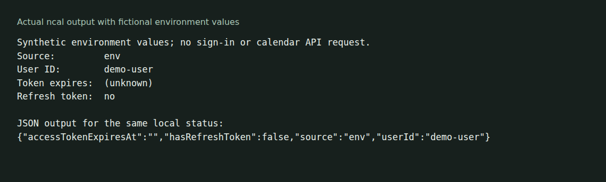

# ncal

A Rust command-line client for Notion Calendar. It uses the unpublished Calendar API described in this repository's research notes. Those endpoints can change independently of this client.



The [offline demo](docs/demo/README.md) shows human and JSON status output. It does not sign in, validate a token or read a calendar.

## Build from source

Install a current stable Rust toolchain, then run:

```sh
git clone https://github.com/olegpustovit/ncal.git
cd ncal
cargo build --locked -p ncal
./target/debug/ncal --help
sh docs/demo/run.sh
```

To install the binary on your path, run `cargo install --locked --path crates/ncal`.

There are no GitHub release assets as of 23 October 2026. The repository contains release automation, but no installer or Homebrew installation is established by that configuration.

## Connect your own account

```sh
ncal auth login
ncal auth status
ncal calendars list
ncal events list --json
```

These commands use your account and network. Browser login and live calendar operations were not tested for the local capture. The CLI also supports importing a desktop or browser session; see `ncal auth --help` for those options.

Credentials may come from environment variables, the OS keychain, a configured file or the desktop application's local data. Importing or signing in stores CLI credentials in the keychain when available, with file storage as a fallback. Keep session data out of Git and shell history. Commands such as `events create`, `events delete` and account removal change remote data.

## Development status

The source build and synthetic local status command were checked on Linux ARM64. `cargo test --workspace` completed, but the workspace currently defines no tests. That command alone does not verify API compatibility or calendar operations.

See the [command and maintainer reference](docs/reference.md) for the command list, output conventions, development hooks and intended release workflow. Versioned observations live in [research](research/); they are not a guarantee that the current service still uses the same contracts.

[MIT license](LICENSE)
